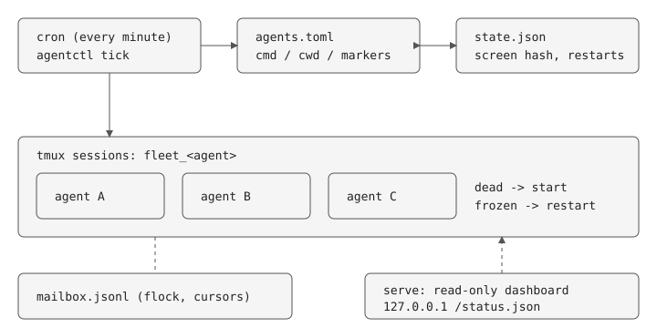
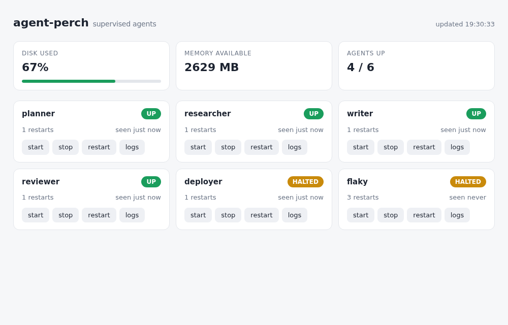

# agent-perch

[English](README.md) | 繁體中文

一個小型 supervisor，讓一台機器上長時間運行的 AI agent 行程（例如 Claude Code bot）保持存活。單一 Python 檔案（約 600 行）、只用標準函式庫、Python 3.11+。

**它做什麼**
- tmux session 死掉就重啟，並偵測 agent 卡在沒人能回應的提示。
- 自動回應已知的 harness 對話框；crash loop（10 分鐘內重啟 3 次）會停下來並發出警報，而不是無限重啟。
- 提供檔案式信箱讓 agent 互傳訊息，以及一個小型網頁儀表板（沒設 token 時唯讀）。

**特色：** 下面每個設計決策都寫明取捨，限制也明確寫出來。它是從一個實際跑在樹莓派 agent 群上的 watchdog 抽出來的。



## 為什麼做這個

在一台樹莓派上跑好幾個常駐 agent，三件事一直出狀況：session 默默死掉、session 卡在沒人能回應的按鍵提示、agent 之間需要互相溝通。這是把處理這些問題的 watchdog 抽出來的通用版。

## 使用

```
cp agents.example.toml agents.toml     # declare agents
python3 perch.py tick               # run from cron every minute
python3 perch.py ls | start | stop | restart | logs <agent>
python3 perch.py send <from> <to|all> "msg"; python3 perch.py inbox <me>
PERCH_TOKEN=secret python3 perch.py serve --port 8080  # dashboard; without the token it is read-only
python3 test_perch.py               # or pytest; needs tmux
```



## Claude Code 快速上手

每個 Claude Code 實例在 `agents.toml` 裡就是一個 agent。下面的 `auto_replies` 與 marker 是實際常駐 bot 群需要的設定；字串請依你的 Claude Code 版本調整。

```toml
[agents.myproject]
cmd = "claude --model sonnet"
cwd = "~/myproject"
auto_replies = [{ match = "Resume from summary", keys = ["Enter"] }]   # harness dialog: answer it, a restart would just show it again
restart_markers = ["Enter to select", "Esc to cancel"]                 # stuck on a menu nobody can answer -> restart
notice_regex = "hit.*limit|resets at|Approaching.*limit"               # usage-limit banner: alert only, never restart
```

```
python3 perch.py tick     # cron: * * * * *  (cd to the repo dir first, or set PERCH_CONFIG)
tmux attach -t perch_myproject
```

它能抓到的狀況：tmux session 死掉、agent 卡在按鍵提示、確認對話框每次重啟後又出現、出現用量上限橫幅、畫面看似正常但 MCP／channel 子行程已死（`health_cmd`）。

## 設定

沒有任何機器專屬的東西被寫死。agent、marker 與告警指令都放在你自己的 `agents.toml`（已被 git 忽略；複製 `agents.example.toml` 開始）。其餘都是環境變數：

| 變數 | 預設值 | 意義 |
|---|---|---|
| `PERCH_CONFIG` | `agents.toml` | agent 宣告檔路徑 |
| `PERCH_HOME` | `~/.perch` | 狀態、事件日誌、mailbox |
| `PERCH_PREFIX` | `perch_` | tmux session 名稱 = 前綴 + agent（要接管既有 session 時設成對應前綴） |
| `PERCH_TOKEN` | 未設定 | 儀表板控制 token；未設定 = 唯讀 |
| `PERCH_TS_USER` | 未設定 | 免 token 的 Tailscale 登入帳號（需搭配 `tailscale serve`，它會加上 `Tailscale-User-Login` header） |

告警目的地（Telegram、Slack、郵件）完全取決於你的 `notify_cmd` 怎麼處理 `$PERCH_MSG`；憑證請放在你自己的腳本裡，不要放進設定檔。

## 設計決策

- **卡死 = 畫面沒變化「且」出現已知 marker。** 單一訊號都會誤判：閒置在提示符的 agent 畫面也不會變；工作中的 agent 輸出途中也可能出現像 marker 的字。兩者同時成立才代表是沒人會回應的按鍵提示。閒置 agent 只有在畫面不變且同時含有 marker 時才有風險，所以請挑卡住提示專屬的 marker。代價：marker 是每個 agent 的設定，必須事先知道。
- **以 tmux 作為行程邊界。** supervisor 當掉 session 仍存活，而且可以 attach 進去看 agent 看到的畫面。代價：存活判斷只是「session 存在」，不代表「工作有在進行」。
- **Mailbox 是檔案，不是注入按鍵。** 往別的 agent 終端機打字會破壞它正在進行的動作。以 flock 做 jsonl 附加、每個讀者各有游標，樸素但可檢視。代價：agent 要自己輪詢，沒有推播。
- **健康檢查 = 選用的 `health_cmd`，連續失敗 2 次才重啟。** session 存在與畫面 marker 看不出「畫面正常但已卡死」的 agent（實際的 bot 群需要檢查它的 MCP 子行程是否還活著）。「健康」的定義只有 agent 的擁有者清楚，所以是一個 shell 指令，不是內建猜測。要失敗兩次而非一次，是避免啟動較慢或瞬間抖動造成重啟迴圈；代價是偵測最多延遲約 2 個 tick。
- **門鈴為每個 agent 選擇加入，且不帶內容。** 沒有東西讓 LLM agent 去讀，檔案 mailbox 就沒用。直接把訊息打進它的終端機雖然可行，但會變成 prompt injection 管道，也會破壞進行中的一輪。所以 supervisor 只在 agent 宣告 `doorbell = true`、畫面已靜止一個 tick（非回合進行中）、沒有卡死 marker、且有未讀訊息時，才打一行固定文字（「run `perch inbox <name>`」）；每批新訊息只響一次。內容仍走檔案。上限：停在未標記選單、畫面靜止的 agent 仍會收到那一行。
- **一把 flock 串起 tick、CLI 與儀表板。** 三者都會讀取—修改—寫回 `state.json`。沒有鎖的話，tick 進行到一半時下的 `stop` 會被 tick 手上過期的副本覆蓋，agent 因此復活。用鎖檔而不是由 daemon 持有狀態，supervisor 才能維持 cron 一次性執行。
- **告警透過使用者提供的 `notify_cmd`，文字放在 `$PERCH_MSG`。** 沒有告警，重啟就是看不見的：這套 Pi bot 群的價值就在於「被通知」。工具本身不該綁死 Telegram/Slack/email client，所以執行你的指令。訊息透過環境變數而非 argv 傳遞，避免 agent 可控的文字被 shell 再解析。通知器失敗只記錄並吞掉：告警壞掉不能拖垮監督。代價：不保證送達，也不重試。
- **Crash-loop 中止：10 分鐘內重啟 3 次就停掉該 agent 並只告警一次。** 開機就死的 agent 否則每個 tick 都被重啟、燒 CPU 又洗版。中止沿用操作員 `stop` 的旗標，所以只有一種「別碰它」機制；只有 `perch start|restart` 會清除並重置額度。從未見過的 agent 第一次開機會計入視窗但不告警（重開機不該每隻 agent 各叫一次）。代價：會反覆抖動但可恢復的 agent 需要人處理。
- **資源告警只在升級時觸發（ok -> warn -> crit）。** 磁碟卡在 85% 應該只通知一次，不是每分鐘一次。門檻可設定；預設值是樹莓派的（磁碟 80/90%、可用記憶體 1000/400 MB）。讀 `/proc/meminfo` 與 `shutil`，不需任何依賴。代價：它監看的是機器而非每個 agent，所以沒有每個 agent 的 CPU/記憶體上限（見「限制」）。
- **`auto_replies`：已知對話框文字 -> 按鍵，而不是重啟。** 有些提示是 harness 層級的，重啟只會再看到同一個提示（例如 Claude Code 的 resume-from-summary 對話框）。比對文字與送出的按鍵都來自你自己的設定，保持機械式：不會注入模型可見的內容。它在卡死偵測之前執行，所以對話框會被回應而不是被殺掉。代價：你必須知道對話框的文字。
- **`events.log` 達 1 MB 輪替，保留一份舊檔。** 在 SD 卡上限制磁碟用量；近期歷史足夠做重啟事後檢討。
- **Marker 比對最後 10 行非空白行，分三種。** `stuck_markers` 需要畫面未變（已解決的錯誤會留在 scrollback，不能觸發）；`idle_markers` 否決它們（提示符頁尾代表這一輪已結束，重啟只會永遠重載同一個畫面）；`restart_markers` 對沒人能回應的提示（方向鍵選單）立即觸發，不多等一個 tick。代價：每個 agent 要調三份清單。
- **`probe_cmd` 與 `notice_regex` 只觀察，從不動作。** `[fleet].probe_cmd` 檢查沒有 agent 擁有的基礎設施（proxy、DNS、port forward），只在 down/up 時告警，因為重啟 agent 修不了。每個 agent 的 `notice_regex` 對每一行不同的符合文字告警一次（例如額度橫幅）。`health_cmd` 會收到 `$PERCH_SESSION`；`PERCH_PREFIX` 設定 tmux session 前綴，讓 perch 能接管既有的 session。
- **無狀態的 supervisor。** `tick` 是讀取 `state.json` 的一次性 cron 任務；不需要再有一個 daemon 來監督 supervisor。
- **即時 logs 與儀表板聊天。** logs 面板開啟時每 3 秒重抓一次。從儀表板對 agent 打字（每個 agent 的 `chat = true`，預設關閉）使用與 start/stop 相同的 token、只能一行、並寫入 `events.log`。這是人在鍵盤前，網頁版的 attach tmux session；不是 agent 對 agent 的通道（那一律走 mailbox）。代價：持有 token 的人可以對所有選擇加入的 agent 打字，所以只讓可接受這件事的 agent 開啟。
- **除非設定 `PERCH_TOKEN`，儀表板控制是關閉的，且只綁 localhost。** 有 start/stop/restart/logs 按鈕；POST 需要 token（常數時間比對），未知 agent 回 404。是純 HTTP，遠端存取請用 TLS 反向代理；token 是共享密鑰，不是逐使用者驗證。

## 對外開放儀表板

它只綁 127.0.0.1。要從其他裝置存取，請放在能驗證「網路」身分的東西後面（例如 `tailscale serve`，只限 tailnet 並附 TLS）。設定 `PERCH_TS_USER` 後，帶有該 Tailscale 登入帳號的請求可免 token（該 header 只有在 `tailscale serve` 後面才可信；本機行程可以偽造，但它們本來就能讀 token 檔）。`PERCH_TOKEN` 是單一共享密鑰，這樣用夠了，但不適合公開網路：不要暴露到那裡。設定 token 後，status、logs、events、start/stop/restart 與 chat 都需要它（頁面本身是靜態的，狀態被拒絕時會要求輸入 token）。選用的 `[fleet] containers = ["name-glob*"]` 會加上唯讀的 Containers 分頁（狀態、image、ports、最近 200 行 logs；只有名稱符合的容器才會傳給 `docker`）。儀表板有 Agents / Containers / Events / System 分頁。`containers_alert`（選用，預設同 `containers`）在符合的容器從 Up 變成非 Up 時通知一次（只觀察，從不重啟）。`cron_logs = ["~/path/*.log"]` 在 System 分頁列出各 log 的新鮮度，最舊的在前；它不知道每個工作預期的間隔，所以由你判斷什麼算過期。`perch init` 會寫出起始設定並印出 cron 行；systemd 範例在 `docs/`。

## 限制（刻意為之）

單機、單租戶。沒有每個 agent 的 CPU/記憶體上限（下一步是 cgroups/ulimit）。沒有驗證、沒有密鑰管理、agent 之間沒有隔離（共用同一個 Unix 使用者）。要代管別人的 agent 這三樣都需要；那是路線圖，尚未實作。

## 起源

由一套實際運作的樹莓派 bot 群 watchdog 通用化而來。Pi 專屬的部分（webhook 入口、nginx 路由、備份、重開機診斷）寫在 [docs/case-study.md](docs/case-study.md)，沒有內建進工具。

## 授權

MIT
